<div align="center">

# Piwin 砚

<p align="center">
  
</p>

**A personal Coding Agent desktop built on Pi**

<sub><i>An inkstone grinds the ink and lets it settle — the best of many tools, gathered on one desk.</i></sub>

<p align="center">
  <a href="https://github.com/mimimaster/piwin/releases"></a>
  <a href="https://github.com/earendil-works/pi"></a>
  <a href="./docs/architecture.md"></a>
  <a href="https://docs.piwinwin.com"></a>
  
  
  <a href="./LICENSE"></a>
</p>

<p align="center">
  <a href="https://docs.piwinwin.com"><b>📖 Docs</b></a> ·
  <a href="#-quick-start"><b>⚡ Quick start</b></a> ·
  <a href="#-whats-new-incremental-updates"><b>🆕 What's new</b></a> ·
  <a href="#-highlights"><b>✨ Highlights</b></a> ·
  <a href="#-architecture"><b>🏛️ Architecture</b></a> ·
  <a href="./docs/adr/"><b>📐 ADR</b></a>
</p>

<p align="center">
  <a href="./README.md">简体中文</a> | <b>English</b>
</p>

<br />

<p align="center">
  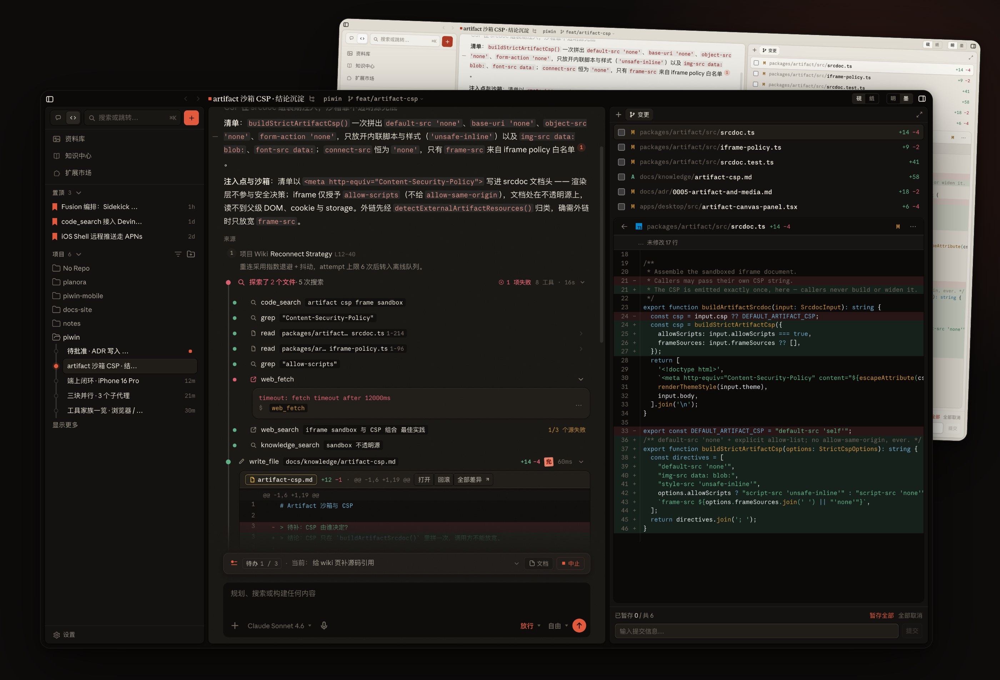
</p>

</div>

Piwin is a desktop Coding Agent built on the Pi SDK (v0.84.2). With Pi you stay in control of features, prompts and tool integrations; Piwin adds the GUI, one-click configuration and multi-device access on top — the client is separate from the Host Runtime, Desktop / Web / Mobile can all connect, and every byte of data stays on your machine.

> The screenshots below show the Simplified Chinese UI.

---

## ⚡ Quick start

Run every command from the repository root. Do **not** run the all-in-one app and a standalone Host on the same machine at the same time — both claim `~/.piwin` (point one of them at a different directory if you want several Hosts).

| Entry | Use case | Develop | Package / run |
| :--- | :--- | :--- | :--- |
| **Desktop** | All-in-one app, works out of the box | `pnpm dev:tauri` | `pnpm package:desktop` → install the dmg / exe |
| **Web** | Browser access, frontend and backend on one port | `pnpm dev:host` + `pnpm dev:web` | `pnpm package:web` → `./dist/piwin-host/start-host.sh` → `http://127.0.0.1:8787` |
| **Desktop Shell** | Lightweight desktop shell for a remote Host | `pnpm dev:tauri:shell` | `pnpm package:desktop-shell` → enter an E2EE pairing code or `ws://` address |
| **Host** | Standalone backend for other clients | `pnpm dev:host` | `pnpm package:host` → `./dist/piwin-host/start-host.sh` |

### Download an installer (no setup required)

Grab the latest build from **[GitHub Releases](https://github.com/mimimaster/piwin/releases)**:

- **macOS**: `piwinwin_<version>_aarch64.dmg` — drag it into Applications
- **Windows**: `piwinwin_<version>_x64-setup.exe` — follow the installer; [Git Bash](https://git-scm.com/downloads/win) is recommended

The installers bundle Node 22 LTS, the Host sidecar, LanceDB and Tauri 2 — nothing else to install.

### Build from source

```bash
git clone https://github.com/mimimaster/piwin.git && cd piwin
pnpm install
pnpm check          # typecheck + architecture rules + unit tests
pnpm dev:tauri      # start the desktop app in dev mode
```

**Requirements**: Node ≥ 22.23.4 · pnpm ≥ 9 · Rust ≥ 1.75 (for the desktop build)

### Web deployment

```bash
pnpm install && pnpm package:web
./dist/piwin-host/start-host.sh   # http://127.0.0.1:8787
```

To expose it beyond localhost, put a TLS reverse proxy in front (Caddy / nginx / Tailscale Serve):

```bash
export PIWIN_HOST_BIND=127.0.0.1
export PIWIN_HOST_PORT=8787
export PIWIN_HOST_TOKEN='replace-with-a-long-random-secret'
export PIWIN_HOST_ALLOWED_ORIGINS='https://ui.example.com'
./start-host.sh
```

---

## 🆕 What's New (Incremental Updates)

Recent releases (`v0.2.0` → `v0.2.9` and latest `main`) bring major additions across **end-to-end encrypted multi-device access, community marketplaces, zero-login free models, context-saving orchestration, and native desktop polish** (see [`CHANGELOG.md`](./CHANGELOG.md) for the full release log):

| Area | New Highlights & Incremental Features |
| :--- | :--- |
| **E2EE Multi-Device Pairing**<br/><sub>ADR 0101 / 0102</sub> | • **Content-Blind Relay + Per-Device E2EE**: relays forward ciphertext frames only — zero plaintext exposure<br/>• **One-Line Pairing Code / Link**: pair Desktop Shell, Mobile Shell, and CLI with your Host; multi-Host book with automatic LAN-direct priority and relay fallback<br/>• **Host Terminal on Mobile**: open an interactive Host terminal shell directly from your phone |
| **Community Marketplace & Remote MCP**<br/><sub>v0.2.6 – v0.2.9</sub> | • **One-Click Ecosystem Install**: search and install **skills.sh community skills**, the **official MCP Registry**, and **GitHub / npm Pi packages**; update Git-installed skills in place<br/>• **Remote MCP Servers**: connect over **Streamable HTTP or SSE** (via Desktop Settings or `piwin mcp add --url`)<br/>• **Native MCP Screenshots**: screenshots returned by MCP tools travel on the native image channel instead of dumping base64/text |
| **Models & Request Control**<br/><sub>v0.2.2 – v0.2.9</sub> | • **Built-in OpenCode Zen Free Models**: use free models out of the box without an API key; dynamic public extension model catalogs refresh on enable<br/>• **Per-Model Custom Request Body**: customize JSON request payloads per model (e.g. OpenRouter upstream routing), plus **Google Vertex AI / AWS Bedrock** and explicit outbound proxy settings<br/>• **OS Credential Store**: Windows secrets are stored in **Windows Credential Manager**, matching macOS Keychain |
| **Orchestration & Context Engineering**<br/><sub>v0.2.0 – v0.2.3</sub> | • **Auto Orchestration Scheme**: recommended default combining Scout recon, Sidekick worktree writes, independent Reviewer gates on large diffs, and async Tester runs<br/>• **Read-Only Code Mode (`piwin_codemode`)**: compose and filter multiple read-only Host tool calls in a single async JS script, paired with `piwin_toolbox` lazy tool discovery<br/>• **Session Handoff**: condense a long session into a structured summary chip and continue in a fresh session<br/>• **GUI ⇄ CLI TUI Switch & External Agents**: one-click toggle between the Desktop GUI and embedded `piwin tui` (shared WebGL atlas), plus **Grok** external ACP agent sessions |
| **Desktop UX & Stability Polish**<br/><sub>v0.2.4 – main</sub> | • **macOS Screenshot & Annotation Editor**: native region capture with arrow, box, mosaic, and text tools — paste straight into the composer or clipboard<br/>• **Artifact Upgrades**: step-through interactive teaching diagrams (Viz Kit), fullscreen view, height memory, and direct text selection copy from static previews<br/>• **Instant Restore & Reading UX**: instant session list on cold start, offline list snapshot, swipeable session rows (`SwipeRow`), reading position anchor, and paged history<br/>• **Native Material & In-App Updates**: macOS vibrancy, Windows 11 Mica, custom wallpapers, and glass ink cards; persistent sidebar **signed in-app update card** with stall recovery; Host watchdog **V8 JIT symbolized hang reports** and clean sidecar reaping on quit |

---

## ✨ Highlights

These are the things Piwin sets out to do well, each packaged as a ready-to-use product experience:

| # | Highlight | In one line |
| :-: | :--- | :--- |
| 1 | [**Hot-install Pi extensions & marketplace**](#1-hot-install-pi-extensions--marketplace) | Install from the marketplace, Git, npm, skills.sh, or the official MCP Registry; active on the next turn — plus [extension.piwinwin.com](https://extension.piwinwin.com/) |
| 2 | [**Subagent orchestration**](#2-subagent-orchestration) | Built-in **Auto** (recommended), Ultra Code, Fusion, and Reviewed Delivery schemes with full worktree review/apply lifecycle |
| 3 | [**Full-duplex voice**](#3-full-duplex-voice) | Talk it through while the Agent works in the background; realtime voice and reasoning models run in parallel |
| 4 | [**Flexible BYOK & built-in free models**](#4-flexible-byok--built-in-free-models) | Reasoning, vision, image, video, realtime voice, embedding, and reranker configured separately — plus built-in **OpenCode Zen** free models |
| 5 | [**One-click web search**](#5-one-click-web-search) | Native model `web_search` and external search providers with fallback routing and headless browser page extraction |
| 6 | [**code_search**](#6-code_search) | A Host built-in Fast-Context code search tool that keeps raw search noise out of the main context |
| 7 | [**Dual-mode Artifacts (Inline & Canvas)**](#7-dual-mode-artifacts-inline--canvas) | Inline cards + dedicated Canvas workspace with built-in charts, Viz Kit step-through diagrams, and static text copy |
| 8 | [**Optimistic locking & one-click undo**](#8-optimistic-locking--one-click-undo) | Host-level structured file edits, write gates, optimistic concurrency control, per-turn native undo, and a live Git diff panel |
| 9 | [**LLM Wiki & FSRS flashcards**](#9-llm-wiki--fsrs-flashcards) | Karpathy-style networked LLM-Wiki + `/learn` Study Space + configurable RAG and FSRS spaced-repetition flashcards |
| 10 | [**Code Mode & progressive toolbox**](#10-code-mode--progressive-toolbox) | Run an async read-only JS script (`piwin_codemode`) to batch Host tool calls and lazily discover tools via `piwin_toolbox` |
| 11 | [**End-to-end encrypted multi-device access**](#11-end-to-end-encrypted-multi-device-access) | Content-blind relay + per-device E2EE pairing across Desktop, Mobile, and CLI — including a Host terminal shell on phones |

<table>
  <tr>
    <td width="50%" valign="top">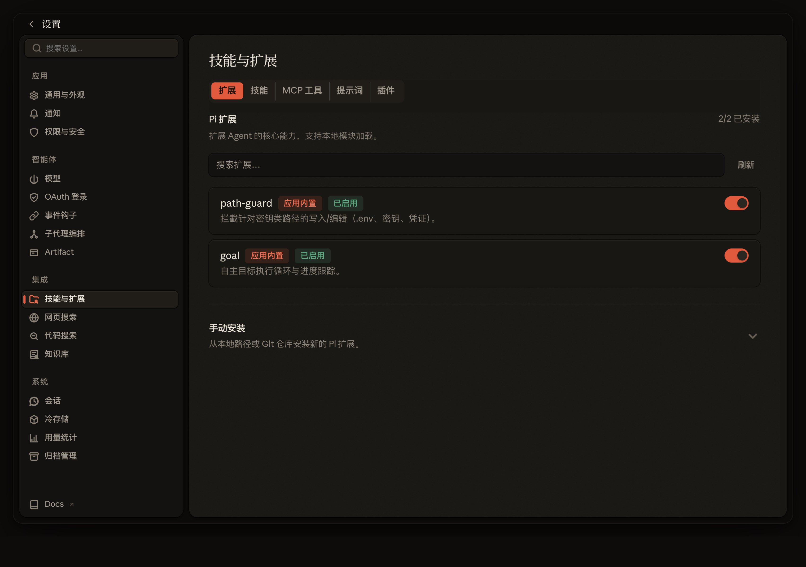<br /><sub><b>1 · Hot-install Pi extensions & marketplace</b></sub></td>
    <td width="50%" valign="top">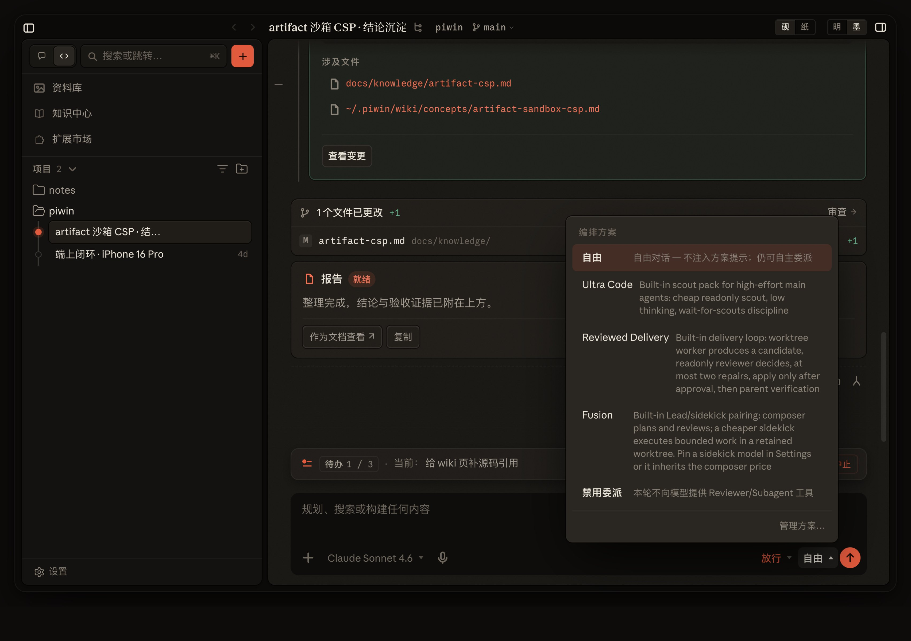<br /><sub><b>2 · Subagent orchestration: switch schemes from the composer</b></sub></td>
  </tr>
  <tr>
    <td width="50%" valign="top">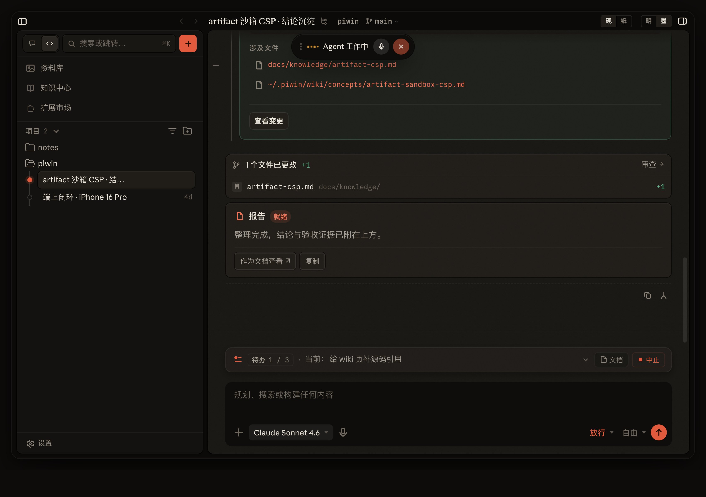<br /><sub><b>3 · Full-duplex voice: the Agent keeps working during the call</b></sub></td>
    <td width="50%" valign="top">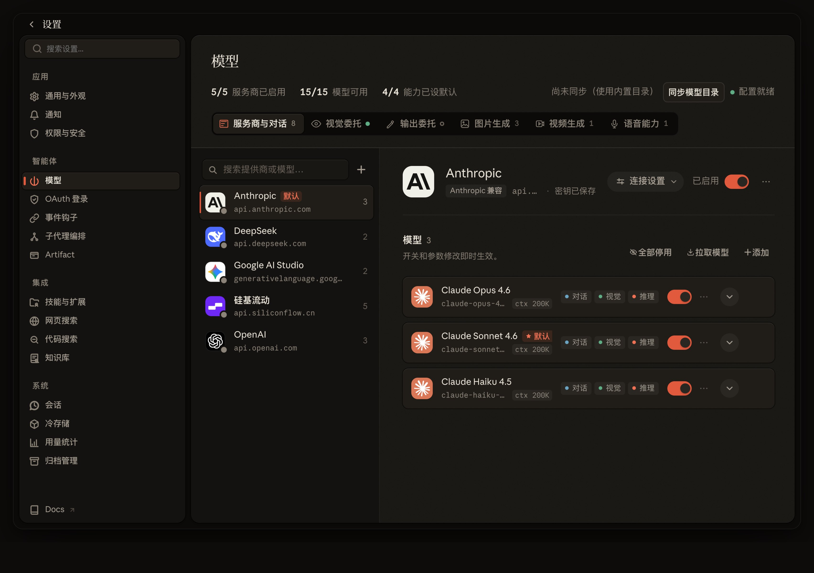<br /><sub><b>4 · Flexible BYOK & models by capability</b></sub></td>
  </tr>
  <tr>
    <td width="50%" valign="top">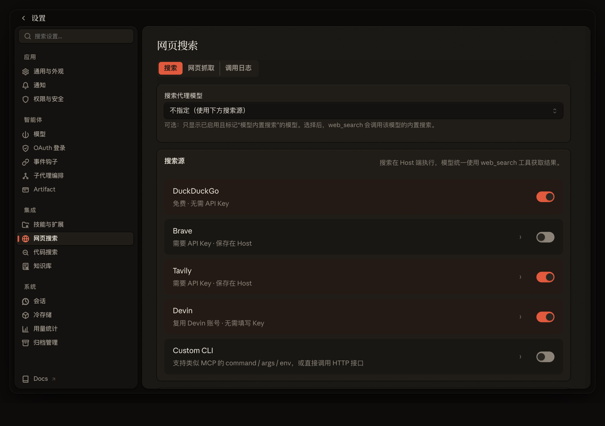<br /><sub><b>5 · One-click web search</b></sub></td>
    <td width="50%" valign="top">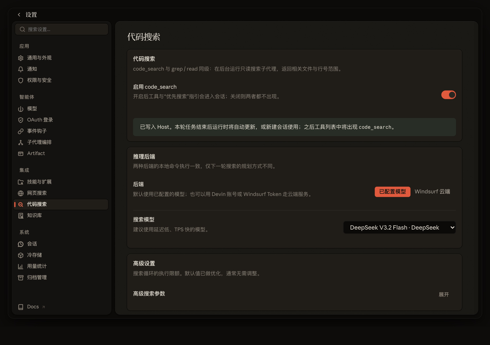<br /><sub><b>6 · code_search</b></sub></td>
  </tr>
  <tr>
    <td width="50%" valign="top"><br /><sub><b>7 · Inline Artifact interactive card</b></sub></td>
    <td width="50%" valign="top"><br /><sub><b>7 · Canvas Artifact workspace</b></sub></td>
  </tr>
  <tr>
    <td width="50%" valign="top">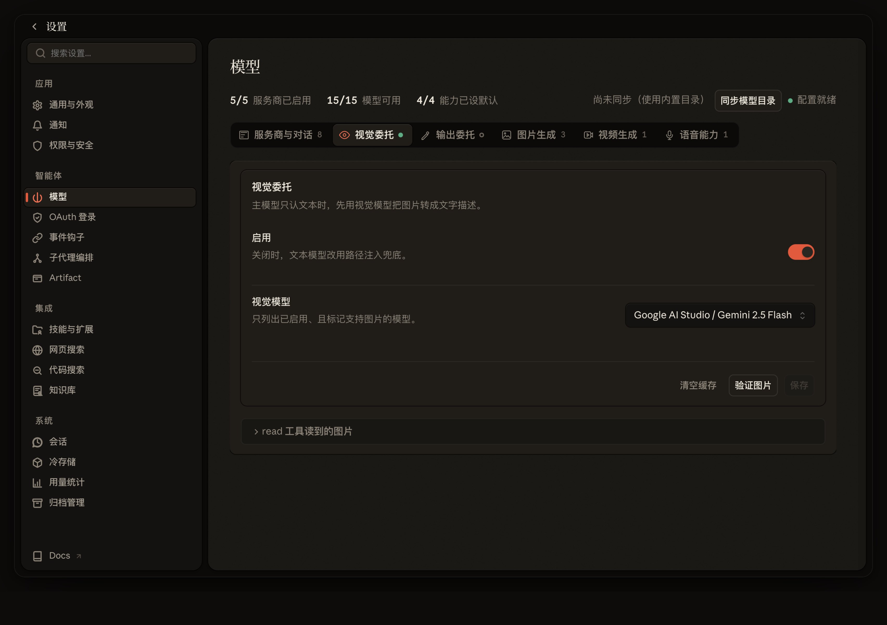<br /><sub><b>Vision delegation: lightweight multimodal model digests screenshots</b></sub></td>
    <td width="50%" valign="top">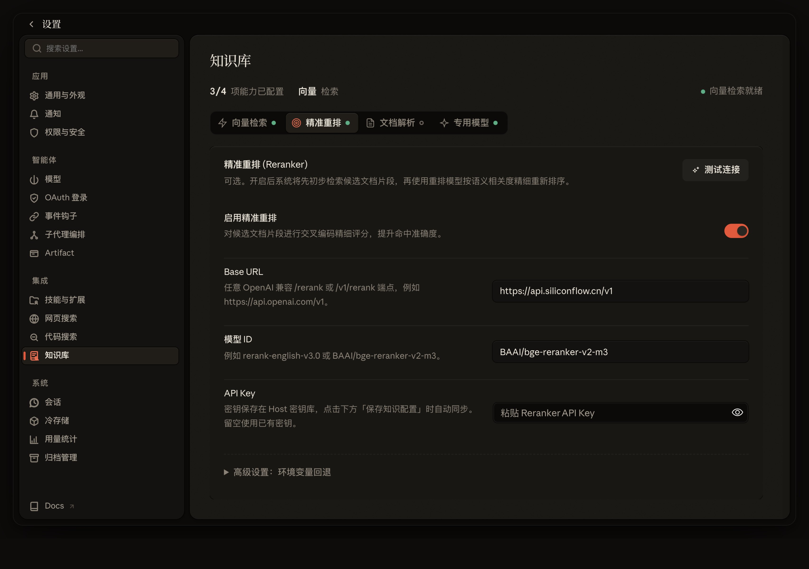<br /><sub><b>9 · Knowledge base: embedding and reranker configured separately</b></sub></td>
  </tr>
</table>

### 1. Hot-install Pi extensions & marketplace

- **Unified ecosystem discovery**: search and install curated extensions, **skills.sh community skills**, **official MCP Registry servers**, and **GitHub / npm Pi packages** from one marketplace — or load from a Git URL / local path, or ask the Agent to call `capability_install` / `extension_install` in chat. Git-installed skills can be updated to the latest upstream commit in one click.
- **Local & remote MCP servers**: supervise local stdio MCP servers or connect to **remote MCP servers over Streamable HTTP and SSE** (in Desktop Settings or via `piwin mcp add --url`). MCP screenshot results stay on the native image channel.
- **Hot activation**: a running task is never interrupted. Once the current Run finishes, the next turn mounts the new extension and refreshes dynamic model catalogs automatically; the session tree and chat history stay intact.
- **Coverage**: extension Tools, event Hooks, custom Providers, and confirm / select / input dialogs (scoped per session with badge notifications) all work in the desktop app; terminal-only TUI extensions are flagged up front.
- Extensions live under `~/.piwin/extensions/`, with [extension.piwinwin.com](https://extension.piwinwin.com/) available as the companion registry.

### 2. Subagent orchestration

Switch schemes from the composer's orchestration picker (or preselect for new sessions / run `/auto`). Built-in schemes are modeled on proven engineering workflows:

| Scheme | Solves | How |
| :--- | :--- | :--- |
| **Auto (Recommended)** | Balanced cost & quality | Combines read-only **Scout** recon and isolated **Sidekick** worktree writes, enforces an independent **Reviewer** before applying large changes, and starts an async **Tester** after apply |
| **Ultra Code** | Context rot in the main session | Implemented after the *Saving 5.6 Sol* breakdown of Codex Ultra: broad searches, research, and verification go to read-only **Scout** subagents. Raw grep output, file dumps, and dead ends stay in a disposable child context; only the distilled conclusion flows back. Scouts can be pinned to a cheap model |
| **Fusion** | Lower cost without losing quality | Modeled on Cognition's Devin Fusion: the current session is the **Lead** (a frontier model) and only plans, resolves ambiguity, and does the final review; mechanical implementation goes to a cheaper, reusable **Sidekick** child session. The two exchange only briefs and results — **never the full conversation history** — keeping prompt caches warm |
| **Reviewed Delivery** | Merge quality | A **Worker** produces a candidate change in its own Git worktree; a read-only **Reviewer** returns a structured verdict (`approved` / `changes-requested`) before anything is applied |

- **Full candidate lifecycle**: review, apply, continue repairing, or discard worktree candidates with base-ref verification.
- You can also build your own schemes: custom roles (scout / coder / reviewer / tester …), per-role models, concurrency limits, and lead discipline — all edited visually in Settings.

### 3. Full-duplex voice

This is not speech-to-text dropped into the input box — **talking and working are separate**:

- The **speaking side** (realtime voice model) handles the live conversation: discuss the approach, correct course, interrupt at any time.
- When code needs changing or tests need running, it **hands a task brief to the reasoning Agent in the session**, which does the work in the background and reports the result back.

Supports **Codex Live** (ChatGPT subscription), **Gemini Live**, and any **OpenAI Realtime-compatible** endpoint.

### 4. Flexible BYOK & built-in free models

Configure models by capability rather than a flat vendor list, with a default model and connection test for each role:

| Capability | Used for |
| :--- | :--- |
| Chat / reasoning | Your main coding model, in Chat and Agent modes |
| Vision delegation | Reading images on behalf of text-only models (OCR + feature extraction, saving 70–90% context tokens) |
| Reply writer | Optional: a lightweight model rewrites the final reply |
| Image generation | The `image_gen` tool; results land in the local library |
| Video generation | The `video_gen` tool; text-to-video / image-to-video |
| Realtime voice | The Live full-duplex voice channel |
| Embedding / reranker | Knowledge base vectorization and reranking |
| code_search backend | A configured model, or a Devin account / Windsurf token |

- **Built-in OpenCode Zen (zero login)**: ships with the OpenCode Zen provider extension enabled out of the box — pick from multiple free models immediately without an API key.
- **Providers**: any OpenAI / Anthropic-compatible endpoint (BYOK), Google Vertex AI, AWS Bedrock, or one-click OAuth for official subscriptions (Kimi Coding / Codex / Claude / Grok / Copilot / Devin).
- **Fine-grained request control**: customize per-model JSON request bodies (e.g. OpenRouter upstream routing), configure an explicit Host outbound proxy, and store secrets in the OS credential store (macOS Keychain / Windows Credential Manager).

### 5. One-click web search

- **Native + external routing**: use native model `web_search` or route across DuckDuckGo (no API key required), Brave, Tavily, Devin, or a local CLI with automatic fallback.
- **Page fetching & headless fallback**: supermarkdown, Jina, or Firecrawl, plus headless browser rendering fallback for JS-heavy pages.
- Switching sources never interrupts a session; `web_search` / `web_fetch` stay available.

### 6. code_search

A **Host built-in tool** on the same level as `read` / `grep`, modeled on Devin (Windsurf) Fast Context. Multi-turn parallel search runs in an isolated read-only subagent and returns only matching file paths, line ranges, definitions, and call relationships — thousands of irrelevant lines never flood the main context, keeping the Agent sharp on long tasks. Reuse your Devin OAuth login / token, or bind any configured model in Settings.

### 7. Dual-mode Artifacts (Inline & Canvas)

- **Inline + Canvas surfaces**: embed interactive cards directly in chat (Inline Artifact) or open wide architectural reviews, audits, prototypes, and dashboards in the right-hand workspace (Canvas Artifact) with fullscreen mode and height memory.
- **Built-in Viz Kit & theming**: theme-adaptive `--piwin-artifact-*` tokens, built-in charts, flow/lane/timeline/tree diagrams, and step-through interactive teaching visuals (`data-piwin-viz`) across `host` and `expressive` styles.
- **Sandboxed & copy-friendly**: isolated in an iframe + CSP sandbox; select and copy text directly from static Artifact previews.

### 8. Optimistic locking & one-click undo

- **Host-enforced write gate & optimistic concurrency**: every file mutation (`edit` / `write_file` / `move_lines` / `move_file` / `delete_file`) goes through the Host write gate with optimistic locking so concurrent turns or subagents never silently clobber files.
- **Turn change sealing & native undo**: the Host records exact file snapshots per turn for one-click native undo (while clearly flagging files modified by raw shell commands).
- **Live Git changes panel**: the titlebar badge shows uncommitted workspace changes — click to inspect diffs by Git scope and commit directly.

### 9. LLM Wiki & FSRS flashcards

- **Karpathy-style LLM-Wiki**: built-in `wiki_read` / `wiki_write` / `wiki_lint` tools synthesize docs, papers, and architecture notes into cross-linked concept pages (`[[Concept]]`) with an automatic `INDEX.md` and `LOG.md`.
- **Study Space (`/learn`)**: plan a concept path, track mastery status and weak points, and build your wiki as you learn.
- **Local RAG & FSRS flashcards**: backed by local LanceDB vectors + custom Embedding / Reranker models; generate Anki-style Q&A or cloze flashcards from wiki pages, documents, or selected chat text and review them on an FSRS schedule.

### 10. Code Mode & progressive toolbox

- **Read-only Code Mode (`piwin_codemode`)**: instead of burning dozens of turns chaining read-only tool calls, the model can run an async JavaScript script in a read-only sandbox to batch, filter, and join multiple Host tool calls in one turn.
- **Progressive toolbox (`piwin_toolbox`)**: discover and invoke MCP and extended Host tools on demand (`search → describe → call`) without bloating the resident system prompt.

### 11. End-to-end encrypted multi-device access

- **Content-Blind Relay + per-device E2EE**: built on ADR 0101, public or self-hosted relays only forward encrypted frames and never see your prompts, code, or keys.
- **Pair in seconds**: generate a pairing code or link in Desktop Settings → Remote / Phone Access to connect **Mobile Shell**, **Desktop Shell**, or **CLI** with automatic LAN-direct discovery and seamless relay failover.
- **Host terminal on phones**: open an interactive terminal shell running on the Host directly from your phone (ADR 0102).

---

## 🧰 More

<table>
  <tr>
    <td width="50%" valign="top">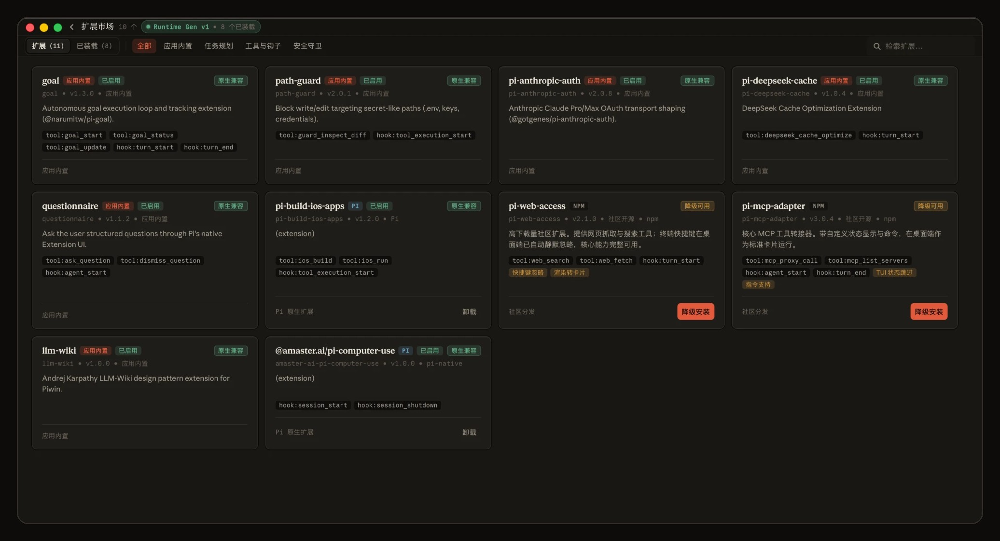<br /><sub><b>Marketplace: built-in, community skills, official MCP, and Pi extensions labeled by compatibility</b></sub></td>
    <td width="50%" valign="top">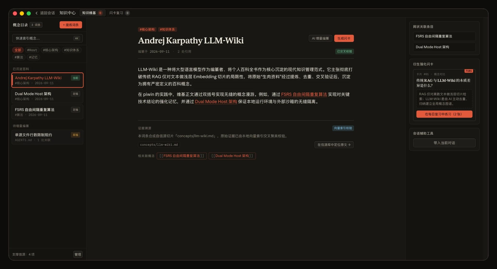<br /><sub><b>Knowledge center: LLM Wiki entries, linked concepts and derived flashcards</b></sub></td>
  </tr>
  <tr>
    <td width="50%" valign="top">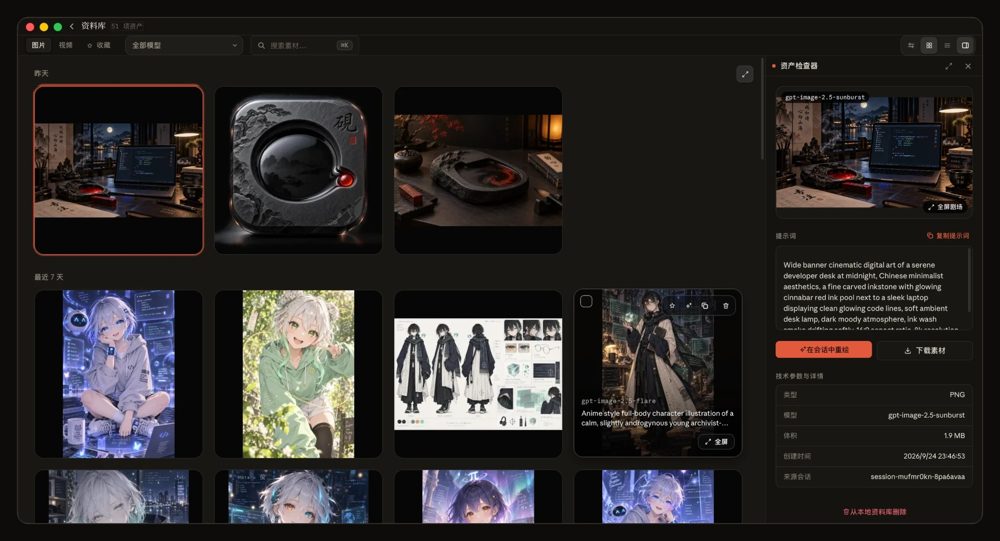<br /><sub><b>Library: generated images and videos in one place, with prompts and source sessions</b></sub></td>
    <td width="50%" valign="top">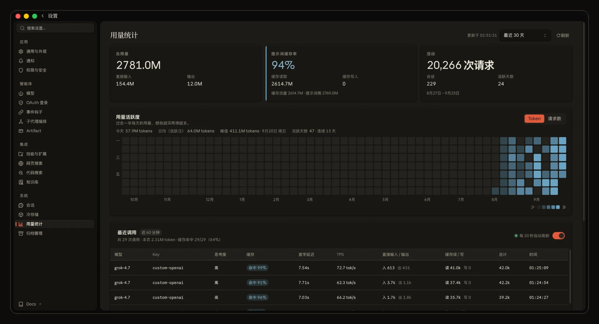<br /><sub><b>Usage: cache hit rate, activity heatmap and per-call details</b></sub></td>
  </tr>
</table>

<p align="center">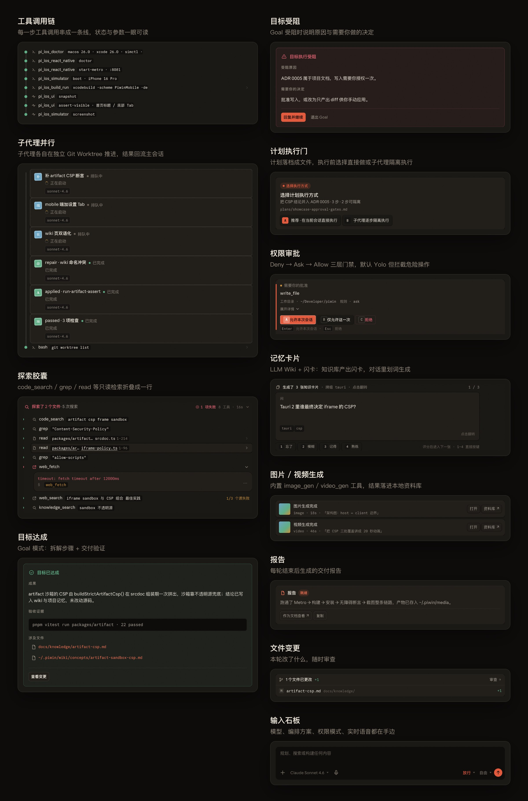</p>

| Capability | Details |
| :--- | :--- |
| **Native Pi SDK integration** | Built on Pi SDK v0.84.2, follows Pi's design principles (Yolo first; plans are persisted as reviewable files) |
| **GUI ⇄ CLI TUI switch** | Toggle between the Desktop GUI and the native CLI TUI (`piwin tui`) from the titlebar (sharing a WebGL atlas); run external ACP agents such as **Grok** |
| **Session handoff** | Condense a long conversation into a structured summary chip and continue seamlessly in a fresh session |
| **macOS screenshot & annotate** | Built-in screen capture and overlay editor (arrows, boxes, pixelation, text) with one-click export to the composer or clipboard |
| **Permission engine** | Three gates — Deny → Ask → Allow; Yolo by default while blocking dangerous commands (`rm`, out-of-workspace writes), with inline prompts in split panes and side chats |
| **Built-in tools** | Multi-tab WebGL terminal, shared Playwright browser workbench (with live human takeover), Canvas, Notes, and more |

- **Chat / Agent / Goal modes** — Chat mode is lightweight and read-only; Agent mode unlocks the full coding toolset; `/goal` opens a structured task & verification panel
- **SQLite session tree & instant restore** — fork, clone, roll back, or open a Side Chat branch; instant cold-start session list with offline snapshots, swipeable rows, reading position memory, and paged history
- **Native window material & appearance** — macOS vibrancy, Windows 11 Mica, custom wallpapers, and glass ink cards, plus streaming caret and adaptive Mermaid diagrams
- **Signed in-app updates & watchdog** — persistent sidebar update card with stall detection and one-click restart; Host watchdog thread records symbolized V8 JIT hang reports before termination and reaps the sidecar on quit
- **Cold storage / usage telemetry / loop guard / Codex pet** — live TTFT, token speed, cache hit rate, user turn count, and reasoning-loop protection

---

## ⚙️ Configuration cheat sheet

| Module | Recommended setup | Docs (Chinese) |
| :--- | :--- | :--- |
| Official subscriptions (OAuth) | Settings → OAuth login; one-click authorization for Kimi / Codex / Claude / Grok / Devin | [Guide](https://docs.piwinwin.com/oauth-login.html) |
| Zero-login free models | Built-in OpenCode Zen extension — select free models right after install | [Guide](https://docs.piwinwin.com/model-config.html) |
| Models & vision delegation | Frontier reasoning model + lightweight free multimodal model (Gemini Flash / GLM) for vision | [Guide](https://docs.piwinwin.com/model-config.html) |
| Code Search | Reuse your Devin OAuth login, paste a Devin token, or bind a configured model | [Guide](https://docs.piwinwin.com/token-acquisition.html) |
| Web Search | Native model search or keyless DuckDuckGo; Tavily API (1,000 free calls/month) / Devin key | [Guide](https://docs.piwinwin.com/web-search.html) |
| Realtime voice | Codex Live / Gemini Live / OpenAI Realtime protocol | [Guide](https://docs.piwinwin.com/realtime-voice.html) |
| Remote & multi-device access | Built-in E2EE Content-Blind Relay pairing (code / QR) or Tailscale mesh | [Guide](https://docs.piwinwin.com/deployment.html) |

---

## 🏛️ Architecture

Clients → one Host authority → local data, with frontend and backend separated.

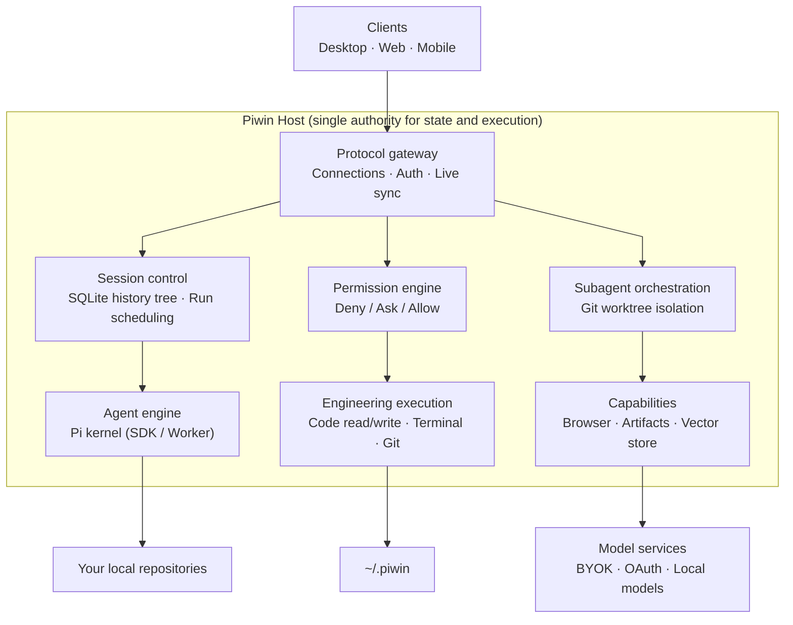

### Layers

| Layer | Location | Responsibility |
| :--- | :--- | :--- |
| Client presentation | `apps/desktop` · `mobile` · `cli` | UI presentation and remote TUI (`piwin tui`); **UI never imports Pi packages** |
| Protocol & E2EE transport | `packages/contracts` · `host-client` · `host-transport` · `host-server` · `apps/gateway` | Bidirectional stdio / WebSocket, per-device E2EE channel, content-blind relay, and replay on reconnect |
| Host composition root | `apps/host` · `packages/host-runtime` | Single source of truth for sessions, permissions, subagent orchestration, and optimistic write gates |
| Agent boundary | `packages/agent-host` · `agent-plugins` | Drives Pi in SDK / RPC mode and adapts external ACP agents (such as Grok) |
| Capabilities | `packages/browser` · `mcp` · `extensions` · `marketplace` · `artifact` · `doc-rag` · `flashcards` · `voice`, etc. | Browser, MCP (local + remote), marketplace, wiki/flashcards, live voice, and artifacts composed on demand |
| Local data | Repositories · `~/.piwin` · OS credential store (Keychain / Credential Manager) | 100% local, nothing uploaded behind your back |

---

## 🗂️ Repository layout

```text
piwin/
├── apps/
│   ├── desktop/          # Tauri 2 desktop app (React 19 + Vite + Mantine)
│   ├── cli/              # Terminal CLI & remote-protocol TUI (piwin tui)
│   ├── host/             # Standalone Host server (WebSocket / E2EE channel)
│   ├── gateway/          # Self-hosted Content-Blind Relay service
│   ├── mobile/           # Mobile shell (iOS / Android)
│   └── docs/             # Docs site (VitePress)
├── packages/
│   ├── contracts/        # Shared types & IPC protocol (pure leaf package)
│   ├── host-runtime/     # Product composition root + permission engine + write gate
│   ├── host-server/      # WebSocket service & E2EE pairing management
│   ├── host-client/      # Client communication, Host book & reconnect
│   ├── host-transport/   # WebSocket / stdio / E2EE frame transport
│   ├── agent-host/       # Pi kernel adapter (SDK / RPC)
│   ├── agent-plugins/    # External agent backend adapters (Grok ACP, etc.)
│   ├── extensions/       # Pi extension runtime hot-loading & lifecycle
│   ├── marketplace/      # Extension / community skill / MCP catalog & installer
│   ├── skills/           # Skill discovery, loading & Git updates
│   ├── browser/          # Shared Playwright browser workbench
│   ├── doc-rag/          # LanceDB vector store + Embedding / Reranker
│   ├── flashcards/       # FSRS flashcard generation & study rounds
│   ├── notes/            # Local notes & LLM-Wiki knowledge base
│   ├── artifact/         # HTML/SVG dual-mode artifact sandbox & Viz Kit
│   ├── mcp/              # MCP supervisor (local stdio + remote HTTP/SSE)
│   ├── voice/            # Live full-duplex voice session orchestration
│   ├── session/          # SQLite session tree, snapshots & cold-storage archive
│   ├── git/              # Git operations & worktree isolation
│   ├── process/          # Child process management & PTY reaping
│   ├── media/            # Multimodal asset storage
│   ├── tools-web/        # Web search & page cleanup
│   └── ui-kit/           # Shared UI component library (Mantine + gesture primitives)
├── scripts/              # Build / signing / notarization / packaging scripts
├── docs/                 # Architecture · ADRs (0001–0102) · specs
└── AGENTS.md             # Rules for AI agents working in this repo
```

---

## 📐 Architecture rules

Every change must follow [`AGENTS.md`](./AGENTS.md). The core rules:

1. `apps/*` **must not** import Pi packages; go through `@piwin/contracts` or the Host protocol
2. `packages/host-runtime` is the **only composition root**
3. **Strict DAG dependencies**: the whole repository forms a directed acyclic graph flowing one way down — `apps → host-runtime → packages/* + agent-host → contracts`. CI checks it and rejects any reverse edge
4. No empty `catch (e) {}`; async work must have timeouts and cleanup
5. New cross-cutting capabilities start as contracts in `@piwin/contracts`

---

## 🤝 Contributing & community

- **Docs**: [docs.piwinwin.com](https://docs.piwinwin.com)
- **Repository**: [github.com/mimimaster/piwin](https://github.com/mimimaster/piwin)
- **Feedback & PRs**: [GitHub Issues](https://github.com/mimimaster/piwin/issues)

---

## 友情链接 / Links

[Linux.Do](https://linux.do) — 新的理想型社区

---

### License

[MIT](./LICENSE) — source code, session history and credentials stay on your machine by default. Your code and your data are yours.
