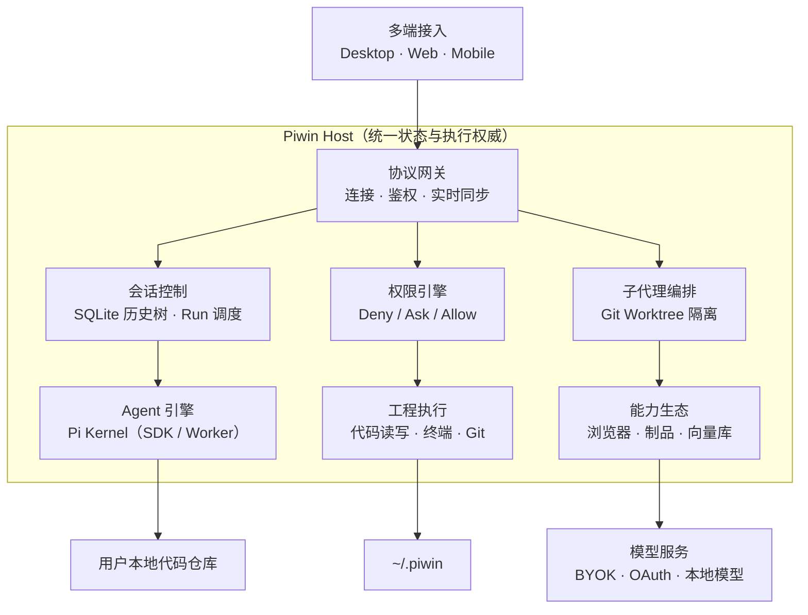

<div align="center">

# Piwin 砚

<p align="center">
  
</p>

**基于 Pi 的面向个人的 Coding Agent Desktop**

<sub><i>天寒水不冻，日用心不倦。</i></sub>

<p align="center">
  <a href="https://github.com/mimimaster/piwin/releases"></a>
  <a href="https://github.com/earendil-works/pi"></a>
  <a href="./docs/architecture.md"></a>
  <a href="https://docs.piwinwin.com"></a>
  
  
  <a href="./LICENSE"></a>
</p>

<p align="center">
  <a href="https://docs.piwinwin.com"><b>文档</b></a> ·
  <a href="#快速上手"><b>快速上手</b></a> ·
  <a href="#近期更新增量速览"><b>近期更新</b></a> ·
  <a href="#核心特色"><b>核心特色</b></a> ·
  <a href="#架构总览"><b>架构</b></a> ·
  <a href="./docs/adr/"><b>ADR</b></a>
</p>

<p align="center">
  <b>简体中文</b> | <a href="./README.en.md">English</a>
</p>

<br />

<p align="center">
  
</p>

</div>

Piwin 是基于 Pi SDK（v0.84.2）的桌面端 Coding Agent。Piwin 是由tauri + node运行时构建的，支持前后端分离，也支持一体包安装，天然支持Desktop / Web / Mobile 接入，不会上传你的任何数据，问题是现在也没啥用户。

---

## 快速上手

所有命令在仓库根目录执行。默认配置和数据空间在~/.piwin，如有特殊需求，请自行配置。

| 入口 | 场景 | 开发 | 打包 / 使用 |
| :--- | :--- | :--- | :--- |
| **Desktop** | 一体包，开箱即用 | `pnpm dev:tauri` | `pnpm package:desktop` → 安装 dmg / exe |
| **Web** | 浏览器访问，前后端同端口，可以远程访问 | `pnpm dev:host` + `pnpm dev:web` | `pnpm package:web` → `./dist/piwin-host/start-host.sh` → `http://127.0.0.1:8787` |
| **Desktop Shell** | 轻量桌面壳，连远程 Host，单独启动 | `pnpm dev:tauri:shell` | `pnpm package:desktop-shell` → 填 E2EE 配对码或 `ws://` 地址 |
| **Host** | 独立后端，供其他客户端连接，适合部署在你自己的vps| `pnpm dev:host` | `pnpm package:host` → `./dist/piwin-host/start-host.sh` |

### 下载安装包（零环境门槛）

前往 **[GitHub Releases](https://github.com/mimimaster/piwin/releases)** 下载最新版：

- **macOS**：`piwinwin_<version>_aarch64.dmg` — 拖入 Applications 即可
- **Windows**：`piwinwin_<version>_x64-setup.exe` — 按指引安装，推荐预装 [Git Bash](https://git-scm.com/downloads/win)，避免模型大战powershell

安装包内置 Node 22 LTS + Host Sidecar + LanceDB + Tauri 2，无需额外环境。

### 从源码开发

```bash
git clone https://github.com/mimimaster/piwin.git && cd piwin
pnpm install
pnpm check          # 类型检查 + 架构红线 + 单测
pnpm dev:tauri      # 启动桌面端开发
```

**环境要求**：Node ≥ 22.23.4 · pnpm ≥ 9 · Rust ≥ 1.75（桌面端编译）

### Web 部署

```bash
pnpm install && pnpm package:web
./dist/piwin-host/start-host.sh   # http://127.0.0.1:8787
```

对外暴露时，在前面放 TLS 反代（Caddy / nginx / Tailscale Serve，懂得都懂，建议搞个tailscale，安全又方便）：

```bash
export PIWIN_HOST_BIND=127.0.0.1
export PIWIN_HOST_PORT=8787
export PIWIN_HOST_TOKEN='换成长随机口令'
export PIWIN_HOST_ALLOWED_ORIGINS='https://ui.example.com'
./start-host.sh
```

---

## 近期更新（增量速览）

近期版本（`v0.2.0` → `v0.2.9` 及最新 `main`）围绕**远程加密互联、全网能力市场、免登录免费模型、上下文降本编排与原生桌面体验**做了大量增量迭代，完整变更见 [`CHANGELOG.md`](./CHANGELOG.md)：

| 领域 | 新增重点与功能（增量） |
| :--- | :--- |
| **端到端加密多端互联**<br/><sub>ADR 0101 / 0102</sub> | • **零知识盲中继（Content-Blind Relay）+ 每设备 E2EE**：公网中继仅转发密文帧，零明文泄露<br/>• **配对码 / 链接一键绑定**：Desktop Shell、Mobile Shell、CLI 扫码或输码即连，支持多 Host 簿管理、局域网直连优先与跨网自动切换<br/>• **手机端宿主终端**：手机端可直接打开运行在 Host 上的交互式终端 Shell |
| **全网市场 & 远程 MCP**<br/><sub>v0.2.6 – v0.2.9</sub> | • **全网检索一键装**：内置市场打通 **skills.sh 社区技能**、**官方 MCP Registry** 与 **GitHub / npm Pi 扩展包**，支持 Git 技能一键更新<br/>• **远程 MCP 服务器**：支持 **Streamable HTTP / SSE** 远程连接（桌面端设置可视化添加 & `piwin mcp add --url`）<br/>• **原生截图通道**：MCP 返回的截图直接作为原生图片渲染与传递，不再转成大段文本 |
| **模型生态 & 请求控制**<br/><sub>v0.2.2 – v0.2.9</sub> | • **内置 OpenCode Zen 免费模型**：开箱免登录直接选用多款免费模型；扩展公开模型目录启用即自动刷新<br/>• **自定义 Request Body**：支持按单模型自定义请求体（如配置 OpenRouter 上游路由），新增 **Vertex AI / AWS Bedrock** 与显式出站代理设置<br/>• **系统凭据库**：Windows 密钥存入系统 **Credential Manager**，与 macOS Keychain 保持一致 |
| **智能编排 & 上下文工程**<br/><sub>v0.2.0 – v0.2.3</sub> | • **Auto 综合编排**：默认推荐方案，融合 Scout 广域侦察 + Sidekick Worktree 写入 + 大改动独立 Reviewer 审查 + Tester 验证<br/>• **只读 Code Mode（`piwin_codemode`）**：模型用单段 async JS 脚本一次性编排组合多个只读 Host 工具，配合 `piwin_toolbox` 按需懒加载工具目录<br/>• **长会话交接（Session Handoff）**：一键将长会话收成结构化摘要芯片，在干净新会话中无缝接力<br/>• **GUI ⇄ CLI TUI 双界面 & 外部代理**：标题栏一键切换桌面 GUI 与内嵌 `piwin tui` 终端界面（共享 WebGL 纹理），支持接入 **Grok** 等外部 ACP 代理会话 |
| **桌面交互 & 稳定性打磨**<br/><sub>v0.2.4 – main</sub> | • **macOS 原生截图与标注**：内置框选截图与悬浮标注编辑器（箭头、选框、马赛克、文字），一键贴入对话或剪贴板<br/>• **Artifact 体验升级**：新增分步交互教学图（Viz Kit）、全屏模式、高度记忆、静态预览直接划词复制，漏写代码块闭合或含 XML 包裹也能识别<br/>• **极速恢复与阅读**：冷启动秒开会话列表、离线列表快照、会话行滑动操作（SwipeRow）、阅读位置锚点记忆与历史分页<br/>• **原生材质与自更新**：macOS 毛玻璃、Windows 11 Mica 材质、自定义壁纸与墨石玻璃卡片；侧栏常驻**签名应用内更新**（含下载卡死检测）；Host 看门狗 **V8 JIT 符号化卡死诊断**与退出自动回收 Sidecar |

---

## 核心特色

Piwin 真正想做好的就这几件事，每一件都封装成了开箱即用的产品体验：

|  #  | 特色                                                         | 一句话                                                                                                           |
| :-: | :--------------------------------------------------------- | :------------------------------------------------------------------------------------------------------------ |
|  1  | [**Pi 扩展与全网市场热安装**](#1-pi-扩展与全网市场热安装)                      | 市场 / Git / 本地一键装，对接 Git、npm、skills.sh 与官方 MCP Registry，提供 [extension.piwinwin.com](https://extension.piwinwin.com/) 方便插件改造 |
|  2  | [**子代理编排**](#2-子代理编排)                                      | 内置 Auto、Ultra Code、Fusion、Reviewed Delivery 等方案，Worktree 隔离 + 审阅合入全生命周期，推荐使用内置 **Auto** 方案                  |
|  3  | [**全双工语音**](#3-全双工语音)                                      | 说话和干活分开，支持你边语音边 coding，可以一边跳舞，一边看原子弹爆炸                                                                        |
|  4  | [**灵活的 BYOK 与内置免费模型**](#4-灵活的-byok-与内置免费模型)                | 推理、视觉委托、生图、视频、实时语音、Embedding、Reranker 独立配置；内置 **OpenCode Zen** 免登录免费模型，支持每模型自定义请求体与 OAuth 订阅                  |
|  5  | [**Web Search 一键配置**](#5-web-search-一键配置)                  | 支持模型原生 `web_search`，也支持多种外部搜索渠道与网页抓取（含无头渲染兜底）降级路由，十分灵活方便                                                      |
|  6  | [**code_search**](#6-code_search)                          | Host 内置的 Fast-Context 代码检索工具，让主上下文保持干燥，避免垃圾工具输出稀释注意力，从而精进模型决策                                                 |
|  7  | [**Artifact 双模态画布**](#7-artifact-双模态画布)                    | Inline 内嵌卡片 + Canvas 独立面板，内置图表与分步交互教学套件（Viz Kit），密集型信息美观直观，静态预览可直接划词复制                                           |
|  8  | [**乐观锁与并发控制**](#8-乐观锁与并发控制)                                | 实现 Host 级别编辑工具与写门禁、乐观锁并发控制，支持按回合原生一键撤回（Undo）与 Git 范围 Diff 面板，当然还是建议配合 Git 使用                                |
|  9  | [**LLM Wiki 与闪卡**](#9-llm-wiki-与闪卡)                        | 基于 Karpathy LLM-Wiki 模式的网状概念库 + `/learn` 学习空间 + 自配置 RAG 流程与 FSRS 记忆闪卡，学习新领域的利器                                  |
| 10  | [**Code Mode 与渐进式工具箱**](#10-code-mode-与渐进式工具箱)             | 模型用一段只读 JS 脚本一次性编排组合多个 Host 工具调用（`piwin_codemode`），配合 `piwin_toolbox` 懒加载工具目录，大幅减少多轮工具往返与上下文消耗            |
| 11  | [**端到端加密多端互联**](#11-端到端加密多端互联)                             | 零知识盲中继（Content-Blind Relay）+ 每设备 E2EE 密钥配对，手机 / 远程桌面壳 / CLI 跨网安全连入家中 Host，手机端可直接操作宿主终端                         |

<table>
  <tr>
    <td width="50%" valign="top"><br /><sub><b>1 · Pi 扩展与全网市场热安装</b></sub></td>
    <td width="50%" valign="top"><br /><sub><b>2 · 子代理编排：输入框一键切换方案</b></sub></td>
  </tr>
  <tr>
    <td width="50%" valign="top"><br /><sub><b>3 · 全双工语音：通话中 Agent 在后台工作</b></sub></td>
    <td width="50%" valign="top"><br /><sub><b>4 · 灵活的 BYOK 与按能力配模型</b></sub></td>
  </tr>
  <tr>
    <td width="50%" valign="top"><br /><sub><b>5 · Web Search 一键配置</b></sub></td>
    <td width="50%" valign="top"><br /><sub><b>6 · code_search</b></sub></td>
  </tr>
  <tr>
    <td width="50%" valign="top"><br /><sub><b>7 · Inline Artifact 内嵌交互卡片</b></sub></td>
    <td width="50%" valign="top"><br /><sub><b>7 · Canvas Artifact 独立画布工作台</b></sub></td>
  </tr>
  <tr>
    <td width="50%" valign="top"><br /><sub><b>视觉委托：轻量多模态模型替主模型看图</b></sub></td>
    <td width="50%" valign="top"><br /><sub><b>9 · 知识库：Embedding / Reranker 独立配置</b></sub></td>
  </tr>
</table>

### 1. Pi 扩展与全网市场热安装

- **全网生态检索与一键装**：除官方精选目录外，内置市场直接打通 **skills.sh 社区技能**、**官方 MCP Registry** 以及 **GitHub / npm 上的 Pi 扩展包**；也支持 Git URL / 本地路径加载，或在对话里让 Agent 调 `capability_install` / `extension_install` 直接帮你装。已安装的 Git 技能支持一键拉取上游更新。
- **远程与本地 MCP 全支持**：不仅托管本地 stdio MCP 进程，还支持直接连接 **Streamable HTTP / SSE 远程 MCP 服务器**（可在桌面端设置添加，或通过 `piwin mcp add --url` 配置），MCP 返回的截图直接走原生图片通道展示。
- **热生效**：正在跑的任务不会被打断——当前 Run 结束后，下一轮对话自动挂载新扩展与公开模型目录；会话树和聊天记录原样保留，不用重启客户端。
- **能力覆盖**：扩展提供的 Tools、事件 Hook、自定义 Provider、确认 / 选择 / 输入类对话框（多会话角标提示，不抢焦点）都能在桌面端直接用；纯终端 TUI 类扩展会被明确标记，不会装上就坏。
- 扩展统一放在 `~/.piwin/extensions/`，并提供 [extension.piwinwin.com](https://extension.piwinwin.com/) 方便查阅与改造插件。

### 2. 子代理编排

在输入框的「编排方案」里一键切换（也支持 `/auto` 指令与新会话预选），内置方案均根据公开技术文章与工程实践实现：

| 方案                  | 解决什么   | 怎么做                                                                                                                                              |
| :------------------ | :----- | :----------------------------------------------------------------------------------------------------------------------------------------------- |
| **Auto（推荐）**        | 综合成本与质量 | 有效利用不同模型特性，综合融入 Scout 广域侦察与 Fusion 独立工作树写入，大改动自动触发独立 Reviewer 审查，合入后异步拉起 Tester 验证，集成本与效用于一身，适合绝大多数日常开发任务                              |
| **Ultra Code**      | 主上下文腐烂 | 依据《拯救 5.6 Sol》对 Codex Ultra 的拆解实现：主代理把广搜、调研、核验派给只读 **Scout** 子代理，原始的 grep 结果、文件内容、死路都留在用完即弃的子上下文里，只有蒸馏后的结论回流；Scout 可钉便宜模型，避免“子代理继承主模型”把额度烧光 |
| **Fusion**          | 降本且不掉智 | 对照 Cognition 的 Devin Fusion 实现：当前会话是 **Lead**（前沿模型），只做计划、解释歧义和终审；机械实现交给可复用的轻量 **Sidekick** 子会话。两边只交换 brief 与 result，**从不传完整对话历史**，各自的提示词缓存都能保住 |
| **Reviewed Delivery** | 严控合入质量 | **Worker** 在独立 Git Worktree 里产出候选改动，**Reviewer** 只读审查并给出结构化裁决（Approved / Changes Requested），通过后才合回主工作区                                   |

- **候选结果全生命周期**：子代理在独立 Git Worktree 中的产出支持可视化**审阅（Review）、应用（Apply）、继续修复（Continue）或丢弃（Discard）**，合入前自动校验分支基线。
- 也可以自建方案：自定义角色（scout / coder / reviewer / tester …）、每个角色用什么模型、并发上限和主代理纪律，全部在设置里可视化编辑。（这些就是些 cosplay，真要玩，建议自定义契约，约定好子代理限制和输入输出，代码反正都是开源了，可玩性很高）

### 3. 全双工语音

**说话和干活分开**：

简单说就是一边聊天，一边干活，其实是 realtime 模型和推理模型同时在工作，就是 Codex 那个，效果还是蛮不错的——说话面负责实时语音交流、打断纠正思路；需要改代码、跑测试时把任务交接给后台会话里的 Agent 执行，做完再用语音告诉你结论。

支持 **Codex Live**（ChatGPT 订阅）、**Gemini Live** 和 **OpenAI Realtime 兼容协议**。

### 4. 灵活的 BYOK 与内置免费模型

| 能力 | 用途 |
| :--- | :--- |
| 对话 / 推理 | 主力 Coding 模型，Chat 与 Agent 模式 |
| 视觉委托 | 替纯文本模型看图（粘贴截图自动 OCR + 特征提炼，省下 70–90% 上下文 Token） |
| 输出委托 | 可选，用轻量模型改写最终回复 |
| 图片生成 | `image_gen` 工具，结果落进本地资料库 |
| 视频生成 | `video_gen` 工具，文生视频 / 图生视频 |
| 实时语音 | Live 全双工语音通道 |
| Embedding / Reranker | 知识库向量化与重排序 |
| code_search 后端 | 已配置模型，或 Devin 账号 / Windsurf Token |

- **内置 OpenCode Zen 免登录即用**：开箱自带 OpenCode Zen 扩展通道，无需配置 API Key 即可直接选用多款免费模型；扩展提供的公开模型目录在启用时自动刷新。
- **接入方式极其自由**：任意 OpenAI / Anthropic 兼容端点（BYOK）、Google Vertex AI、AWS Bedrock，或 OAuth 一键登录官方订阅（Kimi Coding / Codex / Claude / Grok / Copilot / Devin）。
- **精细化请求控制**：支持按单个模型自定义请求体（Request Body，如配置 OpenRouter 上游 Provider 路由、推理参数），支持显式配置 Host 出站网络代理；API 密钥安全存储在系统凭据库（macOS Keychain / Windows Credential Manager）。由 Host 统一存储管理，改完下一轮对话即生效。

### 5. Web Search 一键配置

- **原生 + 外部多源路由**：支持开启模型原生 `web_search`，也支持 DuckDuckGo（免 Key，装完就能用）、Brave、Tavily、Devin 或本机 CLI 降级路由；
- **网页抓取与无头兜底**：supermarkdown、Jina、Firecrawl 可选，静态抓取遇到重度 JS 页面时可自动降级无头浏览器渲染提取；
- 切换搜索源不会打断会话，`web_search` / `web_fetch` 始终可用。

### 6. code_search

与 `read` / `grep` 同级的 **Host 内置工具**，参考 Devin（Windsurf）Fast-Context 实现：检索在独立的只读子代理过程中多轮并行完成，只把命中的文件路径、行号范围、定义和调用关系回传给主模型——几千行无关代码不会冲进主上下文，长任务里 Agent 也不容易“变笨”。支持在设置中选择检索引擎并查看状态，可直接复用 Devin OAuth 账号 / Token，也可以指定任意已配置模型。

### 7. Artifact 双模态画布

- **Inline + Canvas 双表面**：对话流内嵌轻量交互卡片（Inline Artifact），复杂架构评审、对比报告、完整页面原型则自动或手动展开到右侧独立工作台（Canvas Artifact），支持全屏检视与卡片高度记忆。
- **丰富的内置可视化套件（Viz Kit）**：内置自适应亮暗主题变量（`--piwin-artifact-*`）、图表组件、泳道/时序/树状图，以及支持流式静态降级的**分步交互教学图**；支持 `host`（贴合宿主）与 `expressive`（自由高表现力）两种风格。
- **开箱好用的阅读体验**：iframe + CSP 严格沙箱隔离；静态预览支持直接划词复制文本，即使模型偶尔漏写代码块闭合或包裹了 XML 标签也能鲁棒识别渲染。

### 8. 乐观锁与并发控制

- **Host 级结构化编辑与乐观锁**：所有文件修改（`edit` / `write_file` / `move_lines` / `move_file` / `delete_file`）均经过 Host 写门禁与乐观锁校验，防止多会话或子代理并发写坏文件。
- **回合级改动封存与一键撤回（Undo）**：Host 精确记录每一轮对话产生的文件变更快照，支持原生级别的一键撤回（命令直接改动的文件也会明确提示不可一键撤回）。
- **实时改动面板**：标题栏实时显示当前工作区未提交改动计数，点开即可按 Git 范围查看拟改 Diff 并直接完成提交。

### 9. LLM Wiki 与闪卡

- **Karpathy 风格 LLM-Wiki 知识库**：内置 `wiki_read` / `wiki_write` / `wiki_lint` 工具，让 Agent 帮你把零散文档、论文和代码架构沉淀为带双向链接（`[[Concept]]`）、索引目录与变更日志的网状概念词条。
- **Study Space（`/learn` 渐进式学习空间）**：围绕任意主题自动拆解概念路径、跟踪掌握状态与薄弱点，边学边沉淀 Wiki。
- **本地 RAG 与 FSRS 记忆闪卡**：基于本地 LanceDB 向量库 + 自定义 Embedding / Reranker 模型精准检索；支持从知识库词条、文档或对话划词一键生成 Anki 风格问答/填空闪卡，按 FSRS 记忆算法安排复习轮次。

### 10. Code Mode 与渐进式工具箱

- **只读 Code Mode（`piwin_codemode`）**：面对需要连续调用十几个只读工具再交叉比对的复杂查询，模型可以直接编写一段 async JavaScript 脚本，在受控只读沙箱里一次性并发调用、循环过滤和聚合多个 Host 工具结果，只把最终结论返回上下文——既快又省 Token。
- **渐进式工具箱（`piwin_toolbox`）**：不把成百上千个 MCP 工具与宿主扩展工具一次性塞爆系统提示词，而是通过 `search → describe → call` 按需懒加载发现与调用，保持系统提示词始终精炼。

### 11. 端到端加密多端互联

- **零知识盲中继（Content-Blind Relay）+ 每设备 E2EE**：内置符合 ADR 0101 的端到端加密通道。即使通过公网 Relay 中继连接，中继节点也只转发密文帧，完全看不到任何对话、代码或密钥。
- **一行配对码 / 扫码即连**：支持在桌面端「远程访问 / 手机访问」中生成配对码或链接，手机端（Mobile Shell）、另一台电脑的轻量 **Desktop Shell** 或 **CLI** 即可安全配对连入，并自动记忆多台 Host、优先直连局域网并在跨网时无缝切换中继。
- **手机端直连宿主终端**：手机壳不仅能看对话、审批权限、体验全双工语音，还能直接打开运行在 Host 上的交互式终端 Shell（ADR 0102），出门在外也能随时掌控家里或工作室的主机。

---

## 更多能力

<table>
  <tr>
    <td width="50%" valign="top"><br /><sub><b>扩展市场：内置 / 社区技能 / 官方 MCP / Pi 扩展，标注兼容程度</b></sub></td>
    <td width="50%" valign="top"><br /><sub><b>知识中心：LLM Wiki 词条、网状关联与衍生闪卡</b></sub></td>
  </tr>
  <tr>
    <td width="50%" valign="top"><br /><sub><b>资料库：生成的图片 / 视频集中管理，保留提示词与来源会话</b></sub></td>
    <td width="50%" valign="top"><br /><sub><b>用量统计：缓存命中率、活跃度热力图与逐次调用明细</b></sub></td>
  </tr>
</table>

<p align="center"></p>

| 能力 | 说明 |
| :--- | :--- |
| **Pi SDK 原生集成** | 基于 Pi SDK v0.84.2，遵循 Pi 设计原则（Yolo First，落档成可审阅的计划文件） |
| **GUI ⇄ CLI TUI 双界面** | 标题栏一键切换 Desktop 图形会话与原生 CLI TUI 终端界面（`piwin tui`），共享 WebGL 终端纹理；支持接入 **Grok** 等外部 ACP 代理会话 |
| **长会话交接（Handoff）** | 一键把超长会话压缩提炼为结构化摘要芯片，自动在干净的新会话中带上摘要接力，彻底告别长上下文降智 |
| **macOS 截图与标注** | 内置原生屏幕框选截图与悬浮标注编辑器（箭头、选框、马赛克、文字），改完一键贴入输入框或导出剪贴板 |
| **权限引擎** | Deny → Ask → Allow 三层门禁，默认 Yolo 但拦截 `rm` 等危险操作与越界写入，支持项目级命令白名单与分屏/侧聊内联审批 |
| **内置工具集** | 多标签 WebGL 终端、共享 Playwright 浏览器工作台（支持人工接管）、Canvas 画布、Note 笔记等覆盖开发全流程 |

- **Chat / Agent / Goal 模式** — Chat 模式更少上下文注入、只读响应快；Agent 模式全功能编码；`/goal` 唤起结构化任务拆解与交付验证面板
- **SQLite 会话树 & 极速恢复** — 支持分叉 / 克隆 / 截断回滚 / 侧聊分支（Side Chat）；冷启动秒开会话列表，支持离线列表快照、阅读位置锚点记忆、历史分页与会话行滑动操作
- **原生窗口材质与外观** — macOS 原生毛玻璃、Windows 11 Mica 材质、自定义壁纸与墨石玻璃卡片，流式输出光标与 Mermaid 图表自适应排版
- **应用内签名更新 & 看门狗** — 侧栏常驻新版本更新卡片，支持下载卡死检测与一键重启更新；Host 内置看门狗线程，卡死自动生成 V8 JIT 符号化诊断报告，退出应用自动回收 Sidecar
- **冷存储 / 用量统计 / 推理死循环保护 / Codex 宠物** — 实时显示首字延迟（TTFT）、吐字速度、缓存命中率与用户轮数，更多细节在使用中发现

---

## 配置速查

| 模块 | 推荐方案 | 文档 |
| :--- | :--- | :--- |
| OAuth 官方订阅 | 设置 → OAuth 登录，一键授权 Kimi / Codex / Claude / Grok / Devin | [指南](https://docs.piwinwin.com/oauth-login.html) |
| 免登录免费模型 | 内置 OpenCode Zen 扩展通道，开箱直接选用多款免费模型 | [指南](https://docs.piwinwin.com/model-config.html) |
| 模型 & 视觉委托 | 主力推理模型 + 轻量免费多模态模型（Gemini Flash / GLM 等）做视觉委托 | [指南](https://docs.piwinwin.com/model-config.html) |
| Code Search | Devin OAuth 登录后直接复用，或填入 Devin Token / 绑定已配置模型 | [指引](https://docs.piwinwin.com/token-acquisition.html) |
| Web Search | 模型原生搜索 / DuckDuckGo 免 Key 起步；Tavily API（1000 次/月免费）/ Devin Key | [指南](https://docs.piwinwin.com/web-search.html) |
| 实时语音 | Codex Live / Gemini Live / OpenAI Realtime 协议 | [指南](https://docs.piwinwin.com/realtime-voice.html) |
| 远程与多端互联 | 内置 E2EE 盲中继配对（扫码 / 配对码即连），或 Tailscale 加密组网 | [指南](https://docs.piwinwin.com/deployment.html) |

---

## 架构总览

客户端 → Host 单一权威 → 本地数据，前后端分离。



### 分层职责

| 层 | 位置 | 职责 |
| :--- | :--- | :--- |
| 多端表现层 | `apps/desktop` · `mobile` · `cli` | UI 呈现与远程 TUI（`piwin tui`），**UI 不导入 Pi 包** |
| 协议与加密传输 | `packages/contracts` · `host-client` · `host-transport` · `host-server` · `apps/gateway` | stdio / WebSocket 双向通讯、每设备 E2EE 通道、零知识盲中继与断线重放 |
| Host 组合根 | `apps/host` · `packages/host-runtime` | 唯一状态权威，统筹会话 / 权限 / 子代理编排 / 乐观锁写门禁 |
| Agent 边界 | `packages/agent-host` · `agent-plugins` | Pi SDK / RPC 双模式驱动与外部 ACP 代理（Grok 等）适配 |
| 能力生态 | `packages/browser` · `mcp` · `extensions` · `marketplace` · `artifact` · `doc-rag` · `flashcards` · `voice` 等 | 浏览器 / MCP（本地+远程）/ 扩展市场 / 知识库与闪卡 / 语音 / 制品按需装配 |
| 本地数据 | 代码库 · `~/.piwin` · 系统凭据库（Keychain / Credential Manager） | 100% 本地可控，零数据私自上传 |

---

## 🗂️ 仓库结构

```text
piwin/
├── apps/
│   ├── desktop/          # Tauri 2 桌面端 (React 19 + Vite + Mantine)
│   ├── cli/              # 终端 CLI 与远程协议 TUI (piwin tui)
│   ├── host/             # 独立 Host 服务端 (WebSocket / E2EE 通道)
│   ├── gateway/          # 自托管零知识盲中继服务 (Content-Blind Relay)
│   ├── mobile/           # 移动端 Shell (iOS / Android)
│   └── docs/             # 文档站 (VitePress)
├── packages/
│   ├── contracts/        # 共享类型 & IPC 协议 (纯叶子包)
│   ├── host-runtime/     # 产品组合根 + 权限引擎 + 写门禁
│   ├── host-server/      # WebSocket 服务 & E2EE 配对管理
│   ├── host-client/      # Client 通信、Host 簿 & 断线重连
│   ├── host-transport/   # WebSocket / stdio / E2EE 帧传输
│   ├── agent-host/       # Pi 内核适配 (SDK / RPC)
│   ├── agent-plugins/    # 外部代理后端适配 (Grok ACP 等)
│   ├── extensions/       # Pi 扩展运行时热加载 & 生命周期
│   ├── marketplace/      # 扩展 / 社区技能 / MCP 市场目录与安装
│   ├── skills/           # 技能发现、加载与 Git 更新
│   ├── browser/          # Playwright 共享浏览器工作台
│   ├── doc-rag/          # LanceDB 向量库 + Embedding / Reranker
│   ├── flashcards/       # FSRS 记忆闪卡生成与复习轮次
│   ├── notes/            # 本地笔记与 LLM-Wiki 知识管理
│   ├── artifact/         # HTML/SVG 双模态制品沙箱与 Viz Kit
│   ├── mcp/              # MCP 监督器 (本地 stdio + 远程 HTTP/SSE)
│   ├── voice/            # Live 全双工语音会话编排
│   ├── session/          # SQLite 会话树、快照 & 冷存归档
│   ├── git/              # Git 操作 & Worktree 隔离
│   ├── process/          # 子进程管理 & 终端 PTY 回收
│   ├── media/            # 多模态资产存储
│   ├── tools-web/        # 网络检索 & 网页抓取清洗
│   └── ui-kit/           # 共享 UI 组件库 (Mantine 封装 + 手势组件)
├── scripts/              # 构建 / 签名 / 公证 / 打包脚本
├── docs/                 # 架构设计 · ADR (0001–0102) · Specs
└── AGENTS.md             # AI Agent 协作规范
```

---

## 📐 架构红线

所有代码变更必须遵守 [`AGENTS.md`](./AGENTS.md)，核心规则：

1. `apps/*` **禁止**导入 Pi 包，必须经 `@piwin/contracts` 或 Host 协议
2. `packages/host-runtime` 是**唯一组合根**
3. **严格 DAG 依赖拓扑**：全仓库依赖关系构成有向无环图，单向向下流动 `apps → host-runtime → packages/* + agent-host → contracts`，CI 自动校验，任何反向边直接拒绝合入
4. 禁止空 `catch (e) {}`，异步任务必须有超时和清理
5. 新跨域能力先在 `@piwin/contracts` 定义契约

---

## 🤝 参与 & 社区

- **文档站**：[docs.piwinwin.com](https://docs.piwinwin.com)
- **代码仓库**：[github.com/mimimaster/piwin](https://github.com/mimimaster/piwin)
- **反馈 & PR**：[GitHub Issues](https://github.com/mimimaster/piwin/issues)

---

## 友情链接

[Linux.Do](https://linux.do) — 新的理想型社区

---

### License

[MIT](./LICENSE) — 所有源码、会话记录与凭证默认存储于用户本地，尊重代码主权与数据隐私。
